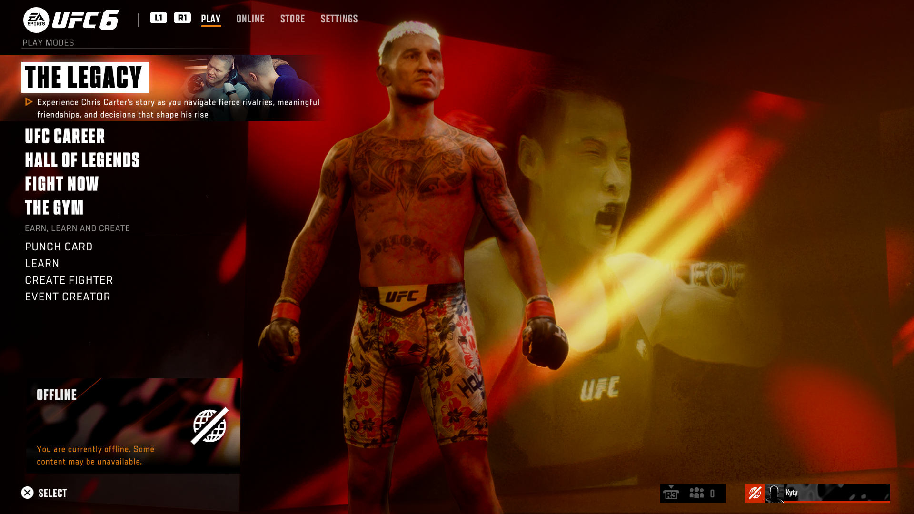
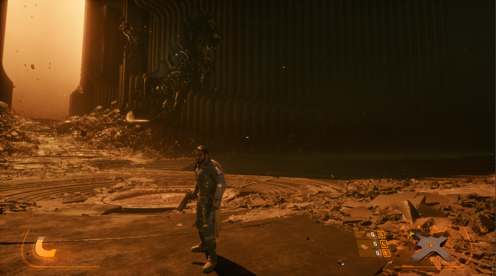

# KytyPS5

Upstream build status:

[](https://github.com/KytyPS5/KytyPS5/actions/workflows/build.yml)
[](https://github.com/KytyPS5/KytyPS5/actions/workflows/build.yml)
[](https://github.com/KytyPS5/KytyPS5/actions/workflows/build.yml)
[](#system-requirements)
[](#current-status)
[](LICENSE)

**[Weekly updates](https://github.com/KytyPS5/KytyPS5/discussions/862)** — game progress, recent fixes and ongoing development.

**[Development on Discord](https://discord.gg/UNrkMqGaBg)** — KytyPS5 development.

KytyPS5 is a free and open-source PlayStation 5 emulator written in C++ for Windows and Linux,
with experimental macOS support. It is based on a heavily modified version of
[Kyty](https://github.com/InoriRus/Kyty). The project is in active development, and behavior
can change significantly between builds.

> [!IMPORTANT]
> KytyPS5 is not affiliated with Sony Interactive Entertainment or PlayStation. The project does
> not distribute games or copyrighted system software. Use only game files that you have obtained
> legally.

## This Fork

The emulator implementation is on the
[`ufc6-latest` source branch](https://github.com/vsajjadx/KytyPS5/tree/ufc6-latest), with
[functional source snapshot `bfe7e4d`](https://github.com/vsajjadx/KytyPS5/commit/bfe7e4de9e5e65165c862d1a765e4f08c626e9f3).
This `main` update changes documentation only; its emulator code remains unchanged.
Get the [MultiFG release](https://github.com/vsajjadx/KytyPS5/releases/tag/KytyPS5-2026-11-14-MultiFG) or browse
[all fork releases](https://github.com/vsajjadx/KytyPS5/releases). The
[earlier FSR 2x release](https://github.com/vsajjadx/KytyPS5/releases/tag/KytyPS5-2026-11-14-93402f6)
remains available as a historical version.

This is an unofficial fork of KytyPS5. Builds and notes are on the
[fork releases page](https://github.com/vsajjadx/KytyPS5/releases); report fork-specific problems
in [this repository](https://github.com/vsajjadx/KytyPS5/issues). Fork changes are tested on
Windows x64 only.

**Compatibility.** This Windows candidate passed all 124 regression tests and controlled UFC 6
samples at every requested Multi factor 2–6 on the animated offline main menu. This is a menu
result, not gameplay or general game compatibility. Wolverine is not confirmed working;
previous tests remained black at 0 FPS with unsupported shader/descriptor operations.

Download the [MultiFG release](https://github.com/vsajjadx/KytyPS5/releases/tag/KytyPS5-2026-11-14-MultiFG) and see the
[functional source snapshot `bfe7e4d`](https://github.com/vsajjadx/KytyPS5/commit/bfe7e4de9e5e65165c862d1a765e4f08c626e9f3).
The package's `BUILD-MANIFEST.json` records its final executable identity and source/binary mapping.

### Frame generation: FSR 2x and experimental Multi 2x–6x

Frame generation is **off by default**. In the launcher's game configuration:

1. Select **AMD FSR 3.1 (2x)** or **Multi (experimental)** as the FG backend.
2. For Multi, select a **Multi multiplier** of **2x, 3x, 4x, 5x or 6x**.
3. Check **Enable frame generation**, save, and start the game. **F3** toggles generation in game.

The multiplier includes the real frame: **5x requests four intermediate images followed by the
real image**. Selecting a backend or factor does not enable generation. Those selections remain
saved while the enable checkbox is off, so a later F3 uses them. FSR always remains 2x; switching
to it preserves the saved Multi factor for later use.

The same options are available on the command line:

```powershell
kyty_emulator.exe --game "<game-folder>" --frame-generation --frame-generation-backend multi --frame-generation-multiplier 5
```

`--frame-generation-backend` accepts `fsr` or `multi` (default `fsr`);
`--frame-generation-multiplier` accepts an integer from `2` to `6` (default `2`). Neither option
alone enables generation. `--frame-generation` or `KYTY_FRAME_GENERATION=1` enables it.

Multi uses this fork's independently written reconstruction kernels with AMD optical-flow data.
One GPU history/flow update supplies the requested intermediate times. A bounded presentation
worker can skip late generated images to keep real frames progressing. The selected multiplier
is a request, not a measured output ratio or physical display rate, and does not raise game FPS.

**Supported frames and fallback.** Both backends require a supported Windows SDR path, an
8-bit RGBA/BGRA or 10-bit A2R10G10B10/A2B10G10R10 frame, and no second video-out layer. FSR
retains its smoothed interval gate of 1.8 configured vblank periods through 150 ms (at 60 Hz,
roughly 6.7–33 game FPS). Multi accepts a smoothed real-frame interval of 1–150 ms. Its first
six flow prepares seed history without publishing intermediates. Unsupported frames, failures
and scene cuts fall back to real images. Changes to enable state, backend, factor, size or
overlays cancel stale generated work; GPU resources remain retained until their recorded use
completes. HDR, extra overlay layers and long-session quality are not established Multi results.

**Current validation.** The latest v6 development candidate passed **124/124 tests in 116.35 s**,
including its complete native GPU group in **22.27 s**. Coverage includes the 90 original
image/region checks, 75 additional static-HUD region checks at every factor 2–6, 20 scene-change
cases, and an FSR → Multi → FSR lifecycle sequence. Existing image thresholds and input/output
integrity checks remain unchanged. An earlier v5 candidate passed its native group in 23.01 s;
that is a different source revision, not a repeated run of v6. The controlled runtime results
and bounded lifecycle smoke are described below; they do not establish all-content correctness.

**Experimental HUD reconstruction.** Multi infers limited stationary/moving layers from the two
composited frames; it receives no game-provided HUD mask. A conditional model now handles the
tested antialiased glyphs and rejects fits without identifying evidence. This is not a promise
of correct reconstruction for every translucent interface, occlusion or scene.

### Observed UFC 6 menu samples

These are **one controlled sample per requested factor**, using the same v6 validation binary
on the animated offline The Legacy main menu. Game FPS is the arithmetic mean of 15 fixed,
consecutive compile-free `PERF` windows. WSI rates use 15 separately selected complete `FG_DIAG`
intervals and their own durations; the two streams are not assumed phase-aligned.

- **2x requested:** 21.73 game FPS; 41.97 successful WSI present calls/s.
- **3x requested:** 21.09 game FPS; 60.07 successful WSI present calls/s.
- **4x requested:** 21.47 game FPS; 78.81 successful WSI present calls/s.
- **5x requested:** 21.23 game FPS; 96.45 successful WSI present calls/s.
- **6x requested:** 21.39 game FPS; 114.19 successful WSI present calls/s.

Native presented start/end observations were clean for all five runs. Before each measurement,
one explicitly identified generated source ordinal was also inspected: 1, 1, 2, 2 and 3 for
2x–6x respectively. Static UI text was clean at these observed points, including visible menu
cinematic transitions. This does not establish every image, all content or long-term stability.

One 6x smoke test also passed F3 off/on, window maximize to 1920×1080, restore to 1282×752 and
normal quit. One unsuccessful present was reported after the measured ROI during resize;
recovery reseeded history and resumed successful presentation without a hang. The exact Vulkan
result was not logged. This was a single smoke, not resize stress or exhaustive lifecycle coverage. Requested factors may skip
outputs through scene guards or cancellation. WSI calls do not measure unique displayed images
or physical scanout. These are not 60 game FPS, gameplay results, or a causal comparison with
older FSR measurements.

**Historical FSR 2x result.** In revision
[`93402f6`](https://github.com/vsajjadx/KytyPS5/commit/93402f6554353bc699c58b133c779810a81b3980),
the UFC 6 main menu ran at about 25 game FPS while successful presentations rose from about
34.77 to 49.94 per second in one before/after test. These are older FSR 2x results, not Multi
measurements. They do not establish 50 or 60 game FPS, physical scanout, smoothness or latency.

<p align="center">
  
</p>

**Known issues.** Earlier Multi presentation exposed warped/duplicated UFC 6 UI glyphs despite
a clean raw game frame. That prompted the new frozen HUD oracle and conditional reconstruction
changes. The completed 2x–6x samples were clean at their observed points; wider content and
long-session quality remain unestablished. One earlier
frame-generation-off run with diagnostics on showed black blocks on
the UFC 6 menu fighter; runs without diagnostics and the previous release were clean. Cause
unknown, reproduction pending. The synthetic fixes below do not establish a cure for every
real-game artifact. Long-term stability is not established.

## Current Status

KytyPS5 can boot 2D games and a selection of 3D games, including titles built with Unreal Engine
4/5, Unity, and custom engines. External low-level emulation modules are neither required nor
planned.

Development is currently focused on expanding game compatibility and improving boot reliability.

Windows and Linux are the primary platforms and receive the most testing.

macOS support is experimental. The emulator is built for x86-64 and runs on Apple Silicon under
Rosetta 2, with Vulkan provided by MoltenVK. A small number of titles have been verified in-game
on Apple Silicon hardware; see [Building on macOS](#building-on-macos).

Community game test results are available in the
[KytyPS5 Compatibility List](https://kytyps5.github.io/).

## Bugs and Issues

Compatibility, stability, and performance can vary between versions. You may encounter crashes
or graphical glitches, so please include the version you tested when reporting an issue.

## Screenshots

The gallery below comes from upstream. This fork's verified UFC 6 observation is shown above.

<table align="center">
  <tr>
    <td align="center">
      <strong>Astro Bot</strong><br>
      
    </td>
    <td align="center">
      <strong>Saros</strong><br>
      
    </td>
  </tr>
  <tr>
    <td align="center">
      <strong>Neptunia ReVerse</strong><br>
      
    </td>
    <td align="center">
      <strong>SILENT HILL: The Short Message</strong><br>
      
    </td>
  </tr>
  <tr>
    <td align="center">
      <strong>Demon's Souls</strong><br>
      
    </td>
    <td align="center">
      <strong>UFC 6</strong><br>
      
    </td>
  </tr>
</table>

<p align="center"><em>And many more...</em></p>

## Contributing

Testing games and submitting detailed bug reports are useful ways to contribute. Search existing
issues first, then use the **Game Emulation Status Report** template and attach the complete log file.

Code contributions should be focused, build successfully on the platforms they touch, and include
relevant tests where practical. Windows is the primary target, so a change that alters shared code
should not regress it; changes confined to a platform's own code paths only need to build there. Because KytyPS5 is still evolving quickly, consider opening an issue before
starting a large change.

### Formatting

Set up the clang-format hook after cloning:

Install `pre-commit` using the method appropriate for your platform:

- **Arch Linux / CachyOS:** `sudo pacman -S pre-commit`
- **Other Linux / macOS / Windows:** `python -m pip install pre-commit`

Then install the Git hook:

```bash
python -m pre_commit install --install-hooks
```

It formats staged `.cpp`, `.h`, and `.inc` files in `src`.

## Developer Information

The PS5 graphics architecture is based on AMD RDNA 2. Use AMD's
[RDNA 2 Instruction Set Architecture Reference Guide (document 70648)](https://docs.amd.com/v/u/en-US/rdna2-shader-instruction-set-architecture)
as the primary instruction-encoding reference when working on shader decoding and recompilation.

Important areas of the codebase:

- [`src/graphics/shader/recompiler`](src/graphics/shader/recompiler) — instruction decoding,
  intermediate representation, control flow, resource tracking, and SPIR-V emission
- [`src/graphics/guest_gpu`](src/graphics/guest_gpu) — PS5 (Prospero) GPU formats and command processing
- [`src/graphics/host_gpu`](src/graphics/host_gpu) — Vulkan host backend and resource management
- [`tests`](tests) — focused memory, shader, and resource-tracking regression tests

The renderer targets Vulkan 1.3. Keep shader changes aligned with both the RDNA 2 ISA semantics and
the Vulkan/SPIR-V validation rules.

### Fork frame generation diagnostics and validation

`KYTY_FG_DIAG=1` (exactly `1`; off by default) emits presenter diagnostics. FSR preserves
`FG_DIAG v=1`; Multi emits `v=2`. Multi separates the requested factor, recorded batches/outputs
and successful real/generated/repeated presents, with seed, failure, cancellation and bounded
queue counters. Each row covers its own CPU interval; configuration changes and shutdown close
marked partial rows. The effective numerator/denominator is the successful presentation-kind
ratio for that window, not proof that each input achieved the requested multiplier. A zero
denominator is unknown. Neither format measures physical scanout, unique images, smoothness or
latency (`scanout=unknown`). Guest `PERF` remains a separate stream; the intervals are not assumed
to be phase-aligned, and per-window CPU interval quantiles must not be pooled.

**Reconstruction and scene-change fixes.** Reproduced failures led to these scoped changes:

- Raw optical flow could select a false local match. Bounded photometric candidate propagation
  now accepts a replacement only when it lowers the local RGB patch error. Four fixed spatial
  passes preserve distinct opposing motions rather than replacing them with one global motion.
- Coarse motion alone could move thin UI, and periodic textures could select an incorrect
  alternative even when an opaque pixel was unchanged. Full-resolution endpoint checks now
  preserve exact byte-stationary pixels and validate motion locally. A private experimental
  static/moving model uses supported endpoint observations and nearby stationary evidence for
  antialiased pixels. RGBA8 uncertainty and physical layer constraints must agree; wholly
  unconstrained mixing intervals are rejected. No test mask, known vector or fractional
  reference is available to the renderer.
- Intermittent scene-change results could falsely reject a normal occlusion sequence. A
  [Multi-only, MIT-licensed synchronization adaptation](https://github.com/vsajjadx/KytyPS5/blob/bfe7e4de9e5e65165c862d1a765e4f08c626e9f3/src/graphics/host_gpu/shaders/multi_frame_scd_sync.comp)
  preserves AMD's detector math, threshold and recent-cut history while one workgroup completes
  all nine histograms and three shifts with explicit shared-memory barriers. Multi-specific
  UAV barriers also order the histogram producer, detector and downstream consumers. The
  default FSR path keeps its original SDK shader blob. Switching the same generator between
  modes recreates the appropriate context and rejects an unsubmitted mode switch.

These changes retain the SDK's license notices; the project remains GPL-2.0 as described in
[LICENSE](LICENSE). No claim of general artifact-free reconstruction follows from these tests.

**Bounded presenter.** After first Multi activation, one worker owns GPU presentation and WSI.
Its input mailbox holds at most three jobs; generated images use two fixed sets of at most five
outputs. A batch submits its actual `N-1` images, waits for that generation tick and checks the
completed scene result before any generated image is used. Cancellation, overlay refresh and
reuse retain the latest GPU/presentation tick and the actual last-shown source. Queue limits
and cadence tests cover every factor, stale batches, overruns, shutdown and successful-present
accounting. A driver present call can still block that worker.

**Regression results.** The latest v6 candidate passed **124/124 tests in 116.35 s**; its full
native GPU group passed in **22.27 s**. The prior v5 native run passed in **23.01 s** on a
different source revision. Current coverage retains the original criteria and adds the frozen
HUD controls:

- 90 original image/region checks cover whole-image translation, opposing local motion and
  occlusion, for every factor 2–6. The predeclared RGB MAE <= 8 and RMSE <= 16 byte thresholds
  remain unchanged, together with temporal-position, endpoint/cross-fade, input preservation,
  untouched-border, six-seed-frame, full-mask, invalid-input, reset and resize controls.
- 75 HUD region checks cover all 15 intermediate outputs across factors 2–6: opaque glyphs,
  every antialiased glyph/line edge, a textured opaque panel, near-HUD background and remaining
  visible background. All HUD support pixels stay graded, with unchanged MAE <= 8 and RMSE <= 16
  byte limits. Background is graded only where both motion-mapped endpoint footprints are
  unoccluded; excluded strips are counted from input geometry before looking at GPU output.
  An independent CPU layer reference passes, while whole-composite/global-flow, endpoint,
  cross-fade and alpha-corruption controls fail the appropriate regions. The GPU receives only
  composited endpoint images, not the private test layers.
- 20 detector cases cover normal occlusion and a real black-to-white cut, every factor 2–6,
  each repeated in two fresh SDK/history contexts. Post-completion eight-byte readbacks must
  preserve host-buffer tails and the original scene status, and the two raw scalar/history
  words must repeat bit-for-bit. Normal occlusion measured `0.00139999995`, equal to the
  independent CPU reference (absolute envelope `0.0002`), with recent history bits zero.
  True cuts measured `0.999998987`, with recent history nonzero and the actual scene gate
  rejecting generated presentation. Raw scalar/history vectors are not hardcoded in the tests.
- The same-generator FSR → Multi → FSR control checks explicit submission/completion,
  fresh warm-up, static legacy output restoration and rejection of a switch while the
  preceding batch remains unsubmitted.

**Launcher verification.** The native configuration dialog exposed all 2x–6x choices. Multi 5x
was saved and reopened with frame generation still disabled; the two CLI/config regression
tests passed. This checks configuration/persistence separately from kernel/runtime results.

Run the GPU group with `shader_recompiler_compute_tests --multi-frame-generation-only`, the
focused detector/lifecycle cases with `--multi-frame-scene-change-only`, or the HUD case with
`--multi-frame-hud-only`. The CPU reference uses
only the synthetic endpoint pixels; the detector readback is recorded after the original batch
completes, without injecting pre-warp capture commands. The full validation runs used precommit executable
`0E2E3C55…554AB9`, matching the functional code in `bfe7e4d` apart from two whitespace-only
cleanups before commit. A later label build has its own exact hash and smoke evidence in the
release manifest; the requested multiplier is never substituted for measured output.

**Runtime counter scope.** All five controlled samples used Multi/diagnostics on, draw-flush 0,
512 KiB download window, red-zone protection on, spin 0 and default audio. Each observed only the
offline menu; different animated moments do not form a randomized A/B test.

- Requested 2x: 653 real + 609 generated calls in 30.0679795 s; scene-guard events 44, superseded 0, late 0, dropped real 0, failed present 0.
- Requested 3x: 634 real + 1173 generated calls in 30.0825031 s; scene-guard events 44, superseded 7, late 0, dropped real 0, failed present 0.
- Requested 4x: 642 real + 1729 generated calls in 30.0833287 s; scene-guard events 46, superseded 57, late 0, dropped real 0, failed present 0.
- Requested 5x: 637 real + 2262 generated calls in 30.0578941 s; scene-guard events 47, superseded 99, late 0, dropped real 0, failed present 0.
- Requested 6x: 638 real + 2795 generated calls in 30.0649724 s; scene-guard events 51, superseded 138, late 0, dropped real 0, failed present 0.

Repeated/blank successful calls were zero in these windows. A scene-guard count is not a
verified count of real cinematic cuts. Pending batches may cross window boundaries, so these
counters are retained rather than forced into a requested-factor identity.

**Historical FSR 2x comparison (`93402f6`).** One sequential before/after pair used identical
settings (1080p, Immediate present mode, 60 Hz vblank, 512 KiB download window, dummy audio,
generation and diagnostics on) in the animated UFC 6 main menu, over 15 consecutive windows
without shader compilation. Before: 764 generated and 288 delayed real presents in 30.260 s
(34.7654/s), 476 real frames replaced unshown. After: 757 and 756 in 30.295 s (49.9422/s), none
replaced, failed or repeated. Separately measured game rates were 25.26 and 25.00 FPS. Streams
were not phase-aligned; per-present timestamps were not recorded. This single pair is not a
causal FPS study or a benchmark of the new Multi backend.

## Building

### System requirements

- Windows 10 version 1803, a current Linux distribution, or macOS on Apple Silicon
- A 64-bit x86 processor (on macOS, an Apple Silicon processor with Rosetta 2)
- A Vulkan 1.3-capable GPU with current drivers (on macOS, Vulkan is provided by the bundled
  MoltenVK)

### Build requirements (Windows)

- Git
- CMake 3.22.1 or newer
- Ninja
- Visual Studio 2022 or Build Tools 2022 with the **Desktop development with C++** workload and
  **C++ Clang tools for Windows** component
- Qt 6 for MSVC 2022 64-bit, including Concurrent, Network, and Widgets
- [glslang](https://github.com/KhronosGroup/glslang/releases) (`glslang` or `glslangValidator`) on `PATH`
- Python 3 on `PATH`; the bundled SPIRV-Tools runs it at configure time

The Microsoft C++ compiler (`cl.exe`) is not supported; use `clang-cl`.

Open an **x64 Native Tools Command Prompt for Visual Studio 2022** (or the equivalent Developer
PowerShell), change to the repository root, and initialize the dependencies:

```powershell
git submodule update --init --recursive
```

Configure the project. Replace the Qt path with the version installed on your system:

```powershell
cmake -S . -B _Build/windows -G Ninja -DCMAKE_BUILD_TYPE=Release -DCMAKE_C_COMPILER=clang-cl -DCMAKE_CXX_COMPILER=clang-cl -DCMAKE_PREFIX_PATH="C:/Qt/6.x.x/msvc2022_64"
```

Build the launcher and stage a runnable installation:

```powershell
cmake --build _Build/windows --target launcher
cmake --install _Build/windows --prefix _Build/windows/install
```

The finished application and its runtime dependencies will be placed in
`_Build/windows/install`.

### Building on Linux

Install the toolchain and the libraries the bundled SDL3 needs. Without the audio, Wayland and
udev development packages SDL3 quietly configures itself without those backends, and the resulting
build has no working sound and no gamepad hotplug:

```bash
sudo apt-get install --no-install-recommends \
  clang lld ninja-build cmake git glslang-tools python3 pkg-config \
  libgl1-mesa-dev libx11-dev libxcursor-dev libxext-dev libxfixes-dev \
  libxi-dev libxrandr-dev libxss-dev libxtst-dev libxkbcommon-dev \
  libasound2-dev libpulse-dev libudev-dev libdbus-1-dev libwayland-dev wayland-protocols
```

Qt 6 (Concurrent, Network, Widgets) is required for the launcher — either the distribution packages
(`qt6-base-dev`) or an official Qt installation.

```bash
git submodule update --init --recursive

cmake -S . -B _Build/linux -G Ninja -DCMAKE_BUILD_TYPE=Release \
  -DCMAKE_C_COMPILER=clang -DCMAKE_CXX_COMPILER=clang++ \
  -DCMAKE_PREFIX_PATH="$Qt6_DIR"

cmake --build _Build/linux --target launcher --parallel
cmake --install _Build/linux --prefix _Build/linux/install
```

The install step copies the Qt libraries and plugins next to the binaries, so
`_Build/linux/install` runs without a matching system Qt. FFmpeg is linked statically
from the pinned [KytyPS5 FFmpeg core](https://github.com/KytyPS5/ext-ffmpeg-core)
release, including VP9 and WebM support. System FFmpeg packages are not required.

To build `kyty_emulator` and the `kyty_tests` target without Qt, use a separate build directory:

```bash
git submodule update --init --recursive

cmake -S . -B _Build/linux-no-qt -G Ninja -DCMAKE_BUILD_TYPE=Release \
  -DCMAKE_C_COMPILER=clang -DCMAKE_CXX_COMPILER=clang++ \
  -DKYTY_BUILD_LAUNCHER=OFF

cmake --build _Build/linux-no-qt --target kyty_emulator kyty_tests --parallel
```

As on Windows, the MSVC compiler is not used; Clang is required. `cl.exe` is rejected at configure
time.

The CMake source root is the repository root.

### Building on NixOS

A development shell provides Clang, CMake, Ninja, Qt 6, the Vulkan headers, and the SDL3 backend
libraries. Enter it and configure exactly as on other Linux distributions; the shell exports
`CMAKE_PREFIX_PATH` and `QT_PLUGIN_PATH`, so the `-DCMAKE_PREFIX_PATH="$Qt6_DIR"` argument is not
needed:

```bash
nix-shell # or: nix develop
git submodule update --init --recursive

cmake -S . -B _Build/linux -G Ninja -DCMAKE_BUILD_TYPE=Release \
  -DCMAKE_C_COMPILER=clang -DCMAKE_CXX_COMPILER=clang++

cmake --build _Build/linux --target launcher --parallel
cmake --install _Build/linux --prefix _Build/linux/install
```

The configure step downloads the FFmpeg prebuilts and the `xbyak`, `zydis`, `zstd`, and ZArchive
sources, so it needs network access; a fully sandboxed `nix build` would require vendoring those
inputs. A Vulkan 1.3 driver must be available at runtime (on NixOS,
`hardware.graphics.enable = true`).

### Building on macOS

macOS builds target x86-64 and run under Rosetta 2 on Apple Silicon, so the PS5's x86-64 game
code executes through the same translation layer as the emulator itself. Prebuilt archives are
attached to releases; the steps below are for building from source.

Requirements:

- An Apple Silicon Mac with Rosetta 2 installed (`softwareupdate --install-rosetta`)
- Xcode (or the Command Line Tools)
- Homebrew packages: `brew install cmake ninja glslang python`
- Qt 6 (Concurrent, Network, Widgets) with x86-64 support. The official Qt installation is
  universal and works; Homebrew's Qt is arm64-only and will not link

```bash
git submodule update --init --recursive

cmake -S . -B _Build/macos -G Ninja -DCMAKE_BUILD_TYPE=Release \
  -DCMAKE_OSX_ARCHITECTURES=x86_64 \
  -DCMAKE_C_COMPILER=clang -DCMAKE_CXX_COMPILER=clang++ \
  -DCMAKE_PREFIX_PATH="$Qt6_DIR"

cmake --build _Build/macos --target launcher --parallel
cmake --install _Build/macos --prefix _Build/macos/install
```

The build re-signs `kyty_emulator` with the JIT entitlements it needs to execute translated
guest code; no manual signing step is required. When the launcher is built, the install
also produces `_Build/macos/install/KytyPS5.app` — double-click to launch the GUI.
A flat `kyty_emulator` is kept for CLI usage.

Vulkan comes from MoltenVK. Download `MoltenVK-macos.tar` from the
[MoltenVK releases](https://github.com/KhronosGroup/MoltenVK/releases), then copy
`MoltenVK/dynamic/dylib/macOS/libMoltenVK.dylib` next to the flat `kyty_emulator`
(and, for the bundle, into `KytyPS5.app/Contents/Frameworks/`) and ad-hoc sign it:

```bash
codesign --force --sign - _Build/macos/install/libMoltenVK.dylib
# For the bundle (if present):
codesign --force --sign - _Build/macos/install/KytyPS5.app/Contents/Frameworks/libMoltenVK.dylib
codesign --force --sign - _Build/macos/install/KytyPS5.app
```

Release archives already include a signed `libMoltenVK.dylib` (both flat and inside the bundle).

### Regression tests

Build every regression executable and run the registered tests with:

```powershell
cmake --build _Build/windows --target kyty_tests
ctest --test-dir _Build/windows --output-on-failure
```

Use `_Build/linux` instead of `_Build/windows` for a Linux build.

### Visual Studio Code

A ready-made Visual Studio Code setup is included in [`.vscode`](.vscode). It configures CMake
Tools to build the project with Ninja and `clang-cl` and provides launch profiles for both
`launcher.exe` and `kyty_emulator.exe`. It is Windows-only: VS Code settings cannot select a
compiler per platform, so on Linux configure from the command line as shown above.

Before using it:

1. Install the **CMake Tools** and **C/C++** extensions in Visual Studio Code.
2. Update `CMAKE_PREFIX_PATH` in [`.vscode/settings.json`](.vscode/settings.json) to point to your
   Qt 6 MSVC installation.
3. Update the `--game` path in [`.vscode/launch.json`](.vscode/launch.json) for the
   **Debug kyty_emulator** profile.
4. Open the repository in an x64 Visual Studio developer environment, configure the CMake project,
   and select a launch profile from **Run and Debug**.

## Running

Update your graphics driver before reporting rendering problems.

To use the graphical launcher:

```powershell
.\_Build\windows\install\launcher.exe
```

```bash
./_Build/linux/install/launcher
```

```bash
open _Build/macos/install/KytyPS5.app  # or double-click in Finder
```

On first launch, add one or more game folders in the global settings. The launcher searches those
folders recursively for game directories containing `eboot.bin` and ZArchive (`.zar`) game dumps
whose archive root contains `eboot.bin`. Select a detected game and run it from the game list.
ZArchive dumps are mounted read-only and streamed directly; they do not need to be extracted first.

Official release builds include a built-in updater. Leave **Check for updates on startup** enabled,
or click **Check for updates**, then choose **Install Update**. The launcher downloads the package
for your platform from GitHub, checks its SHA-256 checksum, and restarts after installation. Close
any running games first. Settings, saves, patches, and other files outside the release package are
preserved; replacement failures restore the previous files. The installation folder must be writable.
If a package cannot be installed automatically, the updater offers the GitHub release page.
Source and fork builds do not replace themselves with official releases.

The emulator can also be started directly with a legally obtained game directory, ELF file, or
ZArchive dump:

```powershell
.\_Build\windows\install\kyty_emulator.exe --game "D:\Games\ExampleGame"
.\_Build\windows\install\kyty_emulator.exe --game "D:\Games\ExampleGame.zar"
```

```bash
./_Build/linux/install/kyty_emulator --game "/games/ExampleGame"
./_Build/linux/install/kyty_emulator --game "/games/ExampleGame.zar"
```

On macOS, the adjacent flat or app-bundled `libMoltenVK.dylib` is found automatically; no
environment variable is required:

```bash
./_Build/macos/install/kyty_emulator --game "/games/ExampleGame"
```

To override the Vulkan loader, set `SDL_VULKAN_LIBRARY`:

```bash
SDL_VULKAN_LIBRARY=/path/to/libMoltenVK.dylib ./kyty_emulator --game "/games/ExampleGame"
```

Run `kyty_emulator --help` to see the available graphics, logging, validation, profiling, and
debugging options.

### AI Use

AI tools may be used for research, reverse engineering, and development assistance. Contributors
must fully understand, review, and test all code they submit and remain responsible for its
correctness. Repository communication, including pull-request descriptions, code comments, and
issue comments, must come from the human contributor rather than an autonomous AI agent.

Pull requests that include AI-assisted or AI-generated work should disclose the scope of the AI
involvement and describe the human review and testing performed before submission. Unverified or
untested generated changes may be closed without review.

## License

KytyPS5 is licensed under the [GNU General Public License version 2](LICENSE)
(`GPL-2.0-only`).

This project is based on the original [Kyty](https://github.com/InoriRus/Kyty), which was released
under the MIT License. Kyty's original copyright and license notice are preserved in
[`LICENSES/Kyty-MIT.txt`](LICENSES/Kyty-MIT.txt). Third-party components remain subject to the
licenses included with those components.

## Special Thanks

- [InoriRus/Kyty](https://github.com/InoriRus/Kyty) — KytyPS5 is based on a heavily modified version
  of the original Kyty project.
- [shadps4-emu/shadPS4](https://github.com/shadps4-emu/shadPS4) — reference for understanding PS4
  memory behavior, GPU resource aliasing and cache coherency,
  and the AVPlayer implementation.
